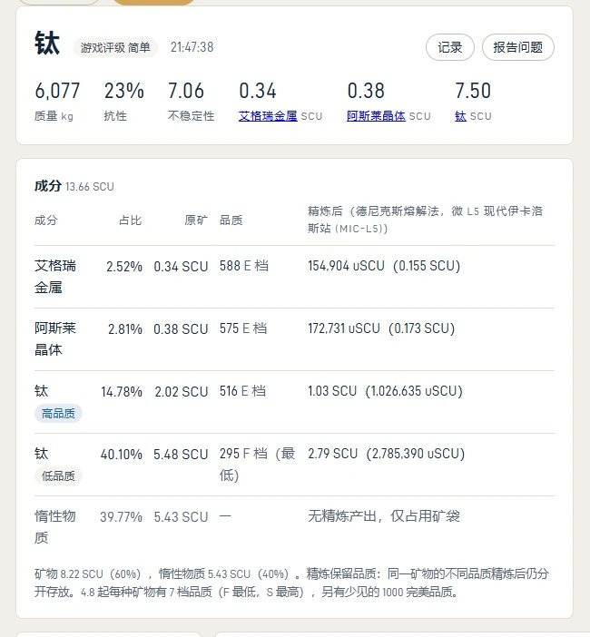
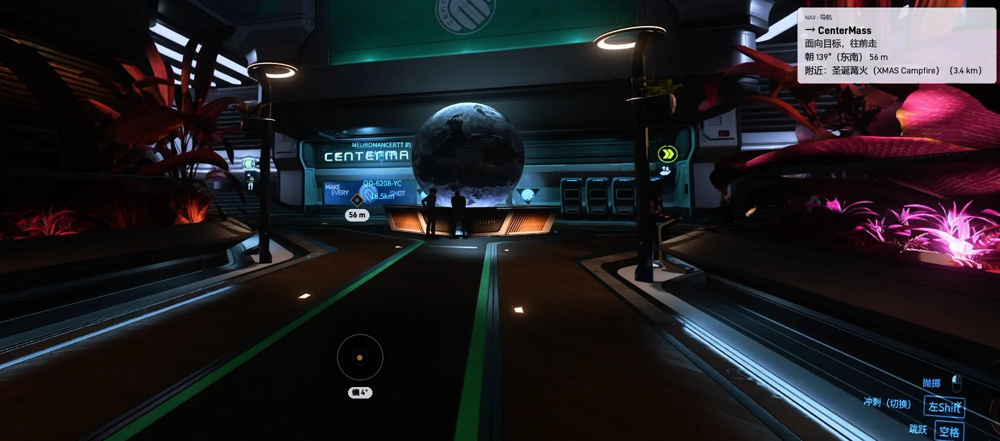
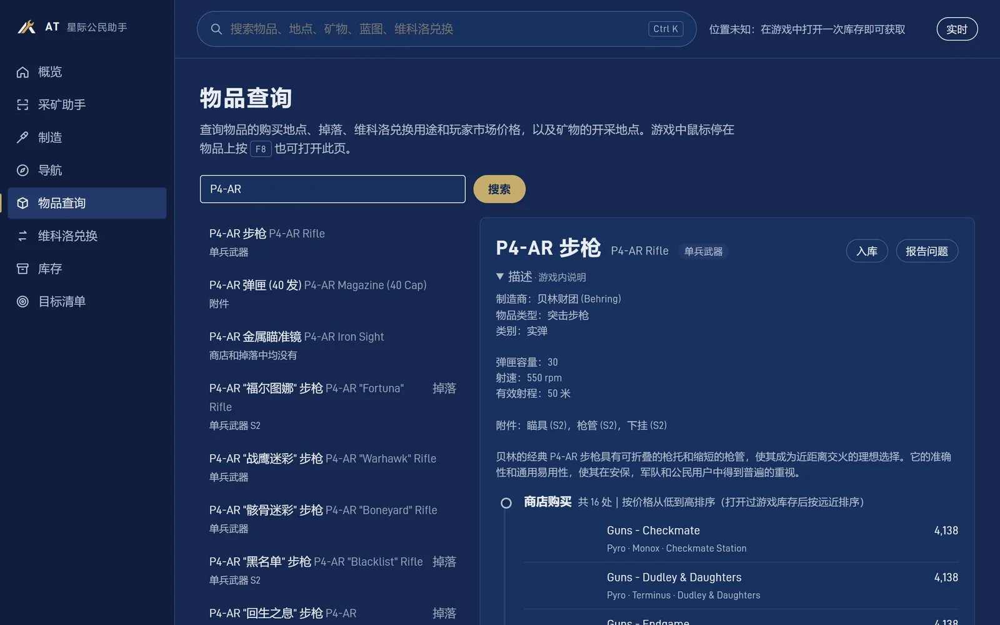
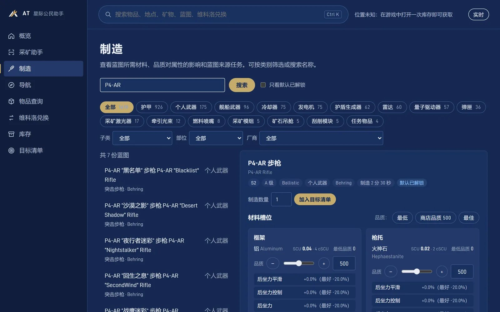

# AT 星际公民助手（Astral Toolkit）AI Helped

《星际公民》（Star Citizen）的免费玩家工具：采矿读屏和破碎方案、制造蓝图、导航、物品查询、维科洛兑换、库存和目标清单。Windows 桌面程序，离线运行。

*An unofficial, free Star Citizen helper (mining HUD reader, crafting, navigation, item lookup, inventory). Chinese UI. Licensed under AGPL-3.0.*

## 下载

- **国内下载（推荐）**：点上面的按钮，或复制地址：https://at-dl-1323647399.cos.ap-guangzhou.myqcloud.com/releases/v1.1.1/AT-win-Setup.exe
- **海外下载**：https://dl.astral-trade.com/releases/v1.1.1/AT-win-Setup.exe ，或 [GitHub 发行版](https://github.com/Adm-TT/Astral-Toolkit/releases)

**安装**：双击 `AT-win-Setup.exe`。Windows 提示「已保护你的电脑」时，点「更多信息」→「仍要运行」。不需要安装 Python，不需要管理员权限。装好后会自动提示新版本，升级不影响设置和记录。

详细用法见 [使用说明.txt](使用说明.txt)，使用前请阅读 [免责声明.txt](免责声明.txt)。

## 截图

## 功能

- **采矿助手**：读游戏画面上的雷达信号和扫描面板，告诉你是什么矿、几块，给出破碎方案（用哪个矿头、功率开多少），算精炼后能拿到多少、值多少 aUEC
- **制造**：蓝图要什么材料、从哪来；拖材料品质看成品属性；按矿反查能做什么；混料计算
- **导航**：去没有量子信标的地方（洞穴、残骸、自定义路标），悬浮窗提示机头怎么转；小行星带导航
- **物品查询**：在哪买、掉落、玩家市场价；矿物在哪挖。游戏里鼠标指着物品按 F8 直接查
- **维科洛兑换**：每个兑换要交什么、材料去哪弄
- **库存 / 目标清单**：按地点和仓位记东西，算离目标还差什么

AT 靠截屏识别文字、读游戏写出的日志文件工作；不模拟按键，不读写游戏内存，不改游戏文件。会联网检查更新、下载数据；按 F10 问题反馈时会把整屏截图、最近的识别截图、识别结果、当时位置和日志片段发给作者；F8 认物品名的一行字小截图（认错的都存，认对的抽一部分）也会攒批发送；两项设置里都能关。

**关于风险，说实话：** AT 只截屏识别文字、读游戏日志，不读写内存、不改游戏文件。1.1.2 起删除了全部模拟按键（防挂机、双击 W 自动跑、自动输入 `/showlocation`）。不自动战斗、不自动开船。RSI 用户协议禁止收集游戏信息的第三方软件和自动化软件，读屏处在灰色地带。我们无法保证 CIG / RSI 认可，也无法保证使用不会引发账号调查或限制，请自行判断；介意的话可以只用不读屏的功能（查物品、蓝图、路标）。

## 从源码运行

需要 Windows 10/11 和 Python 3.10–3.13。

1. 双击 `首次安装.bat`：找到合适的 Python（没有就装 3.12），在本文件夹里建 `.venv` 并装好依赖
2. 运行：`.venv\Scripts\python.exe -m sc_mining.run`
3. 第一次打开后在「设置与更新」里点「开始更新」（或者运行 `.venv\Scripts\python.exe -m sc_mining.run update`），游戏数据不在仓库里

跑测试：`.venv\Scripts\python.exe -X utf8 -m tests.run_all`。要先更新过数据；仓库里不带游戏截图，用到截图的测试会自动跳过。

## 目录

| 位置 | 内容 |
|---|---|
| `sc_mining/app/` | 窗口和后台：`server.py` 启动、本机网页服务；`web/` 界面；`api/` 每个领域一个接口文件（Controller），`router.py` 汇总；`engines/` 后台读屏 / 导航引擎，`engines/manager.py` 统一管；`hud_state.py` 悬浮窗提示；`overlay.py` 悬浮窗；`tray.py` 托盘 |
| `sc_mining/tasks/` | 各功能的业务逻辑：交易、库存、目标与制造、导航、采矿、F8 识别、F6 盘点、系统与更新；界面接口经 `app/api/` 转到这里 |
| `sc_mining/core/` | 基础：路径、设置、版本、性能与识别设备、多语言 |
| `sc_mining/mining/`、`navigation/`、`crafting/`、`trade/` | 各领域的计算和数据：采矿识别与破碎计算、星图与定位、制造与物品、查价与库存 |
| `sc_mining/system/`、`update/` | 和系统、游戏打交道（辅助进程、驾驶位检测、显卡识别、问题反馈）；数据下载与升级 |
| `sc_mining/run.py`、`selftest.py` | 命令行入口、自检 |
| `tests/` | 测试，`run_all.py` 自带运行器，不用装 pytest |
| `tools/` | 打包、发布、游戏文件解包等开发工具 |
| `data/`、`userdata/` | 运行时生成：下载的数据、个人设置和记录（不在仓库里） |

## 数据来源和致谢

游戏数据来自下列网站和社区项目，权利归原作者所有（`sc_mining/names_zh.json`、`sc_mining/sc_glossary.json` 摘自汉化包，不属于 AGPL，权利归汉化项目）：SCMiner、UEX、SC Market、scmdb.net、starmap.space、星际公民掉落查询（scl.miao.network）、Star Citizen Wiki API、Star Citizen Wiki（矿物品质分档，CC BY-SA 4.0）、erkul.games、SC汉化盒子及社区汉化项目。游戏文件解包用的是 StarBreaker（MIT）。

用到的开源组件（RapidOCR、ONNX Runtime、NumPy、Pillow、OpenCV、mss 等）和字体的许可证原文见 [第三方许可.txt](第三方许可.txt)。

## 许可

© 2026 Adm_TT。源代码按 [GNU Affero 通用公共许可证第 3 版（AGPL-3.0）](LICENSE) 开源：可以使用、修改、转发和发布修改版；转发 AT 或发布修改版时，须按 AGPL-3.0 让对方能拿到对应的完整源代码，让他人通过网络远程使用修改版时也一样，并保留版权和许可声明。

名称和图标不在 AGPL-3.0 范围内：「AT」「Astral Toolkit」「天枢」「Dubhe」「阿塔」这些名称，以及 AT 的图标、标志和启动画面（文件清单见 [商标和图标说明.txt](商标和图标说明.txt)），© 2026 Adm_TT 保留所有权利。可以按 AGPL-3.0 使用和修改代码，但发布修改版时要换成自己的名称和图标，不能让人误以为是 AT 或作者发布的；如实说明「基于 AT 修改」不受限制。

AT 是玩家自制的非官方工具，与 Cloud Imperium 集团旗下公司无关联。星际公民及源自游戏的名称、图像等内容归 Cloud Imperium Rights LLC 和 Cloud Imperium Rights Limited 所有。

本仓库只包含 AT 客户端；ATA 交易平台、服务器，以及阿塔的形象和声音不在开源范围内。

作者：Adm_TT（游戏 ID）。还没注册星际公民的话，注册时可以填邀请码 `STAR-4CNY-K3YT`：https://www.robertsspaceindustries.com/enlist?referral=STAR-4CNY-K3YT
