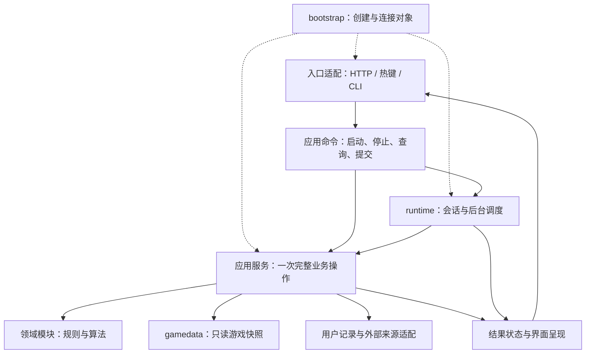
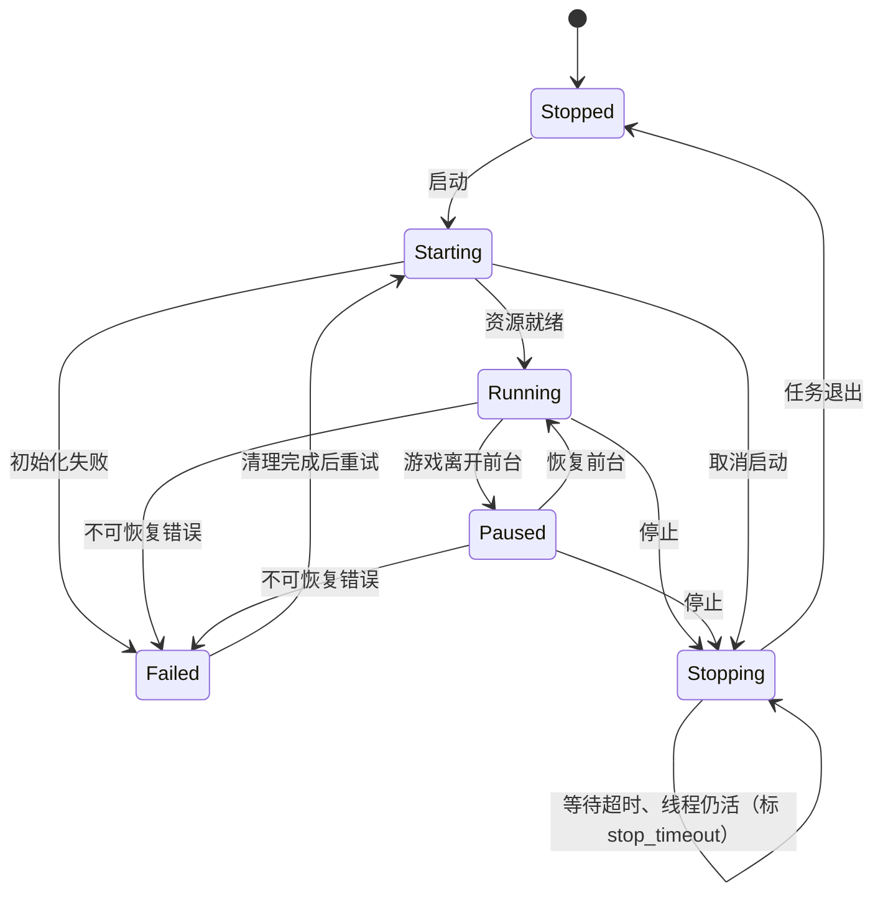

# Astral Toolkit 整体架构与渐进重构方案

版本：1.2 · 架构建议稿  
日期：2026-11-02（v1.2 修订 2026-11-03）  
范围：整个 `astral_toolkit` 主程序包，包括采矿、导航、物品查询、制造/维科洛、库存、目标和后台运行机制。  
源码基线：第 3 节与附录 A 的源码链接固定在提交 `c67b15d20c855e04f269eb747093df0d68c8fee1`；v1.2 按开发分支 `dev`（包名 `astral_toolkit`）修订。  
配套文件：`2026-11-02-gamedata-design.md`、`2026-11-02-ocr-engine-ownership-design.md`；运行时会话循环 / 生命周期 / bootstrap 的细化设计（会话循环设计稿 v4.1）由运行线维护。数据库分离由另一条工作线实施；本文件规定它与功能模块的边界。

**交付状态：架构设计，不表示代码已经改造或 Windows 实机验收通过。** 文中的接口、目标目录和状态模型是本方案提出的设计。已确认的源码事实与设计建议分别说明。不更换 Python 后端、不引入前端框架；v1.2 起新增 C# 悬浮窗与 MSIX 商店版构建（§2.2、§4.5、ADR-01）。

| 版本 | 日期 | 修订 | 依据 |
|---|---|---|---|
| 1.0 | 2026-11-02 | 初稿 | Astra 架构设计 |
| 1.1 | 2026-11-02 | §7.5 按 RT-B3 实际实现改写（提交边界已实现部分 / 尚未实现部分分开写）；停止只封会话不删结果 | 运行线实施反馈 |
| 1.2 | 2026-11-03 | 同源双构建（Velopack 直装 + MSIX 商店）；C# 悬浮窗并入 WinUI 3 外壳；前端 ES modules + Web Components；HUD 两类合同；§7.4 删「超时即 Failed」；§7.5 采矿重开例外与跨端终态合同；新增 §4.5、§7.7；§9.3 商店版安装与数据；§10 加 UI / ST 线、RT 线分批；§11 渲染端合同与总资源基线；ADR-01 / 02 / 08 补充（§12.3）（按 DeepSeek 复审修订） | v1.2 修订提案、Astra 2026-11-03 方向性答复、负责人决定 |

## 1. 架构结论

AT 采用**模块化单体**：一个 Python 后端进程承载功能模块，保留本机 HTTP + 原生 JS（按 ES modules + Web Components 组织）、WinUI3/WebView2 外壳（悬浮窗也由它用 C# 渲染）、现有 OCR 和 Windows 打包链（同一份源码出直装版与商店版两种构建）。各功能通过明确接口协作，后台线程由统一生命周期管理，游戏资料和玩家记录采用不同的数据生命周期。

重构的核心是五项约束：

1. **业务计算不直接操作界面、线程、文件或数据库。**
2. **一次操作所需的依赖和数据版本可以追踪，不靠跨模块全局变量传递。**
3. **采集、识别、计算、结果保存、界面展示各自有明确负责人。**
4. **游戏资料更新不会重置玩家库存；停止功能后，旧任务不能重新显示结果。**
5. **按完整功能链逐条迁移，每条链都能验收和回退。**

数据库分离、模块化和代码重构是三项相互配合的工作：

| 工作 | 解决的问题 | 完成标准 |
|---|---|---|
| 数据库分离 | 游戏资料从哪里读、怎么更新、版本是否一致 | 功能通过 `gamedata` 查询；发布、快照、失败恢复通过验收 |
| 功能模块化 | 谁负责什么、模块之间怎样合作 | 公共接口明确；没有业务模块反向调用界面或任务实现 |
| 模块内部重构 | 一个模块内部如何更容易维护 | 长流程分成可验证步骤，状态归属明确，已有行为保持 |

**实施顺序：先确定边界与合同 → 数据层建设和应用骨架并行 → 完整业务链接入 → 模块内部逐步整理。** 不需要等所有数据库代码写完才讨论架构，也不在依赖尚未准备好时强行迁移功能。

## 2. 目标、约束与方案选择

### 2.1 目标

- 修改一个采矿规则时，主要改采矿模块及其测试。
- 修改数据格式时，主要改导入器和查询适配，不要求界面、引擎一起修改。
- 纯业务测试能在没有游戏、Windows 窗口、真实用户数据和网络的环境中运行。
- 启动、停止、切换前台、配置变化、更新数据等行为可重复验证。
- 保留已有识别效果、排序、数量精度、导航安全检查、库存事务和用户交互。
- 为后续协作提供文件归属和合并边界，减少多人同时修改公共大文件。

### 2.2 固定约束

- Python 3.12 为当前项目基线；沿用 RapidOCR / ONNX Runtime。
- 前端保留 WebView2 + 原生 HTML/JS，按功能用 ES modules + Web Components 组织；不引入前端框架和构建链。
- **同源双构建**：Velopack 直装版之外新增 MSIX 商店版，两者共用全部业务源码。差异只收在打包 / 平台适配层，范围限于：应用更新方式、文件路径策略、包身份、激活、依赖部署、能力声明、进程启动。**业务模块不得判断「是不是商店版」。**
- 游戏运行时资源紧张，后台识别需节流，切出游戏时保留现有暂停逻辑。
- 只读屏幕、日志及项目允许的热键状态/剪贴板；维持现有产品限制。
- 保留本机监听、令牌校验、用户同意与反馈控制，不在结构重构中改变这些行为。
- 没有真实 `data/` 和截图样本时，不能宣称识别、性能和安装环境回归已通过。
- 所有路径由现有路径策略解析，不假定工作目录或安装目录可写。
- 现有 HTTP 路由名、响应结构、SSE 事件是迁移兼容边界。HUD 分两类合同：
  - **可在 UI 线经负责人批准后改变**：布局、文案、分组、摘要保留方式、交互。行为变化须单列，与修改识别 / 排序规则同级审批。
  - **强制合同，任何渲染端不得改变**：会话失效、结果提交顺序、停止终态、旧结果不得复活、F8 异步补充的身份校验。显示「已关闭」不能替代后台停止；终态权威不交给渲染器。

### 2.3 考虑过的方案

| 方案 | 收益 | 成本与适用性 | 本方案决定 |
|---|---|---|---|
| 保持现有依赖，只把大文件拆小 | 改动少，容易快速合并 | 隐式初始化、跨模块状态和反向依赖仍在；后续维护收益有限 | 仅作为局部整理手段 |
| 新建完整第二套程序，逐项重写 | 可以统一所有接口和内部风格 | 需重新找回大量识别边界行为，同时维护两套实现；当前样本与平台验收成本高 | 暂不采用 |
| 在现有程序中建立模块边界，逐链替换实现 | 可以复用有效算法，阶段性发布，每条链可验收 | 迁移期间需要明确的兼容层和文件归属 | **推荐并据此设计** |

这里的推荐是架构建议，不将其表述为用户已经逐项确认的决定。

第一轮不引入微服务、远程数据库、通用插件平台、统一消息中间件、全项目异步改造或通用依赖注入框架。它们不是目前这些耦合问题的必要解法。

## 3. 当前源码说明了什么

本节引用固定提交，避免分支后续更新导致依据漂移。函数规模只用于定位职责聚集，不作为代码质量评分。

| 已确认现象 | 源码依据 | 架构影响 |
|---|---|---|
| 采矿任务模块在导入时取得引擎单例，包含导航标记/HUD 投影逻辑 | [tasks/mining.py](https://github.com/Adm-TT/Astral-Toolkit/blob/c67b15d20c855e04f269eb747093df0d68c8fee1/astral_toolkit/tasks/mining.py#L18) | 导入业务入口可能初始化运行对象；导航展示职责落在采矿任务中 |
| `scan_view()` 同时做采矿计算、制造/目标提示、文本和界面字典组装 | [tasks/mining.py:381](https://github.com/Adm-TT/Astral-Toolkit/blob/c67b15d20c855e04f269eb747093df0d68c8fee1/astral_toolkit/tasks/mining.py#L381) | 业务变化容易同时影响 HTTP、HUD 和后台扫描 |
| 实时引擎用 `_T()` 动态导入任务，再写系统模块的最近结果 | [live.py:16](https://github.com/Adm-TT/Astral-Toolkit/blob/c67b15d20c855e04f269eb747093df0d68c8fee1/astral_toolkit/app/engines/live.py#L16)、[live.py:589](https://github.com/Adm-TT/Astral-Toolkit/blob/c67b15d20c855e04f269eb747093df0d68c8fee1/astral_toolkit/app/engines/live.py#L589) | 动态导入绕过了导入时循环，运行时职责仍互相依赖 |
| 引擎管理器还启动更新、反馈补发、索引和 OCR 预热 | [manager.py:41](https://github.com/Adm-TT/Astral-Toolkit/blob/c67b15d20c855e04f269eb747093df0d68c8fee1/astral_toolkit/app/engines/manager.py#L41) | 资源初始化和业务调用需要集中装配、分别管理生命周期 |
| 目标规划默认向上调用 `tasks.trade`，失败后自行创建 `Trade` | [crafting/goals.py:362](https://github.com/Adm-TT/Astral-Toolkit/blob/c67b15d20c855e04f269eb747093df0d68c8fee1/astral_toolkit/crafting/goals.py#L362) | 计算入口隐藏了持久化对象创建和加载行为 |
| 库存已有事务、修订号、预览与确认机制 | [trade/inventory.py](https://github.com/Adm-TT/Astral-Toolkit/blob/c67b15d20c855e04f269eb747093df0d68c8fee1/astral_toolkit/trade/inventory.py#L29)、[storage.py:85](https://github.com/Adm-TT/Astral-Toolkit/blob/c67b15d20c855e04f269eb747093df0d68c8fee1/astral_toolkit/trade/storage.py#L85) | 这些机制应保留并封装，不与可重建游戏资料合并 |
| OCR 已有独立入口与兼容封装 | [ocr/engine.py](https://github.com/Adm-TT/Astral-Toolkit/blob/c67b15d20c855e04f269eb747093df0d68c8fee1/astral_toolkit/ocr/engine.py#L1) | 可复用现有识别能力，重点调整资源归属和调用方式 |
| F8 先输出本地信息，再由 hover-more 补市场价与掉落 | [tasks/hover.py:141](https://github.com/Adm-TT/Astral-Toolkit/blob/c67b15d20c855e04f269eb747093df0d68c8fee1/astral_toolkit/tasks/hover.py#L141) | 渐进输出需要阶段与请求身份，不能把跨线程补充视为同一个数据库快照 |

当前主程序已有分层意图，也有可复用模块。问题集中在**分层约束没有贯穿初始化、运行状态和跨功能协作**。目标架构沿用有效部分，将这些缺口补齐。

## 4. 总体结构与依赖规则

### 4.1 运行结构

图中实线是调用/结果传递，虚线是对象装配。调用经过接口，不表示可以任意导入对方内部文件。



后台扫描中，应用服务返回结果，由 runtime 校验会话后提交结果状态；同步查询则由入口接收返回值。图中的“应用服务 → 结果状态”表示输出方向，不允许服务越过会话检查自行发布实时结果。

### 4.2 六个职责层

| 层 | 职责 | 禁止承担的职责 |
|---|---|---|
| 入口与呈现 `app/` | 参数解析、调用服务、HTTP/SSE 编码、页面和 HUD 展示 | 采矿收益、材料分配、导航算法、直接 SQL |
| 应用用例 `tasks/` | 获取输入快照，组织一次操作，组合多个功能，返回明确结果 | 窗口绘制、动态查找全局引擎、隐式联网/建库 |
| 领域功能 | 业务规则、匹配排序、数量与质量计算、坐标算法 | 线程创建、真实时钟、文件路径、UI、网络和数据库连接 |
| 运行管理 `runtime/` | 会话、任务调度、暂停/停止、资源竞争、结果提交 | 物品价格规则、制造公式、字符串排版 |
| 数据与平台适配 | 游戏查询、玩家记录、OCR、抓屏、网络、设置和日志 | 反向调用任务实现或界面逻辑 |
| 装配入口 `bootstrap.py` | 解析路径，创建依赖，连接服务，启动与关闭 | 业务算法、日常全局服务查找 |

`tasks/` 继续表示应用用例，避免为了名称把全部入口再搬一次。新建 `runtime/` 的目的，是把后台运行从界面包中分离。

### 4.3 依赖硬规则

1. `app/api` 调用注入的应用服务或命令接口；业务结果经过 presenter 转为现有协议。
2. `tasks` 可以组合多个领域的公共接口、`gamedata` 公共查询和自己声明的数据访问接口。
3. `runtime` 只使用领域的类型/计算服务协议、自己的资源协议和输出接口；**不导入 `tasks` 实现或 `app`**。
4. 领域模块不导入 `tasks`、`app`、`runtime`、`gamedata` 实现、平台库或持久化实现。应用服务把必要事实作为值传进去。
5. 平台/持久化适配器可以实现消费者声明的接口，不能调用上层业务。
6. 跨功能查询由应用服务组织。第一轮不允许领域模块互相导入实现；通用标识通过小型公共值类型传递。
7. `bootstrap` 可以引用所有具体实现。其他模块不能通过 `bootstrap.get_service()` 获得依赖。
8. `__init__.py` 只做轻量公共导出。导入一个功能不能启动线程、打开玩家数据库、加载 OCR 模型或发起网络请求。
9. 不以 `importlib`、`__import__` 或在函数内部导入的方式绕过上述约束。

依赖注入采用普通构造参数或函数参数。只在 I/O、运行控制、时钟等真实边界上使用 `Protocol`；纯函数无需机械增加接口、工厂和基类。

### 4.4 公共接口与内部实现

- 每个领域使用 `api.py` 暴露少量值类型、纯计算入口及必要协议；内部文件不被其他功能直接引用。
- 公共结果使用不可变 dataclass/tuple，内部也避免共享可变容器。
- 跨模块字段必须能说明业务含义；只在 HTTP、SSE、JSON 文件等序列化边界使用无类型字典。
- `contracts/identity.py` 只放真正跨功能的物品引用等值类型。不建立聚集所有 DTO、配置和服务的公共大包。
- 一次操作中有多个查询接口时，应用服务显式传递同一个借用的数据视图。数据视图不跨线程，也不长期存入服务对象。

### 4.5 语言与进程边界

| 进程 / 语言 | 负责 | 不负责 |
|---|---|---|
| Python 后端 | 识别、业务计算、会话与运行状态、数据、本机 HTTP + SSE 服务 | 窗口宿主、原生渲染 |
| C# 外壳（WinUI 3） | 窗口宿主、悬浮窗渲染、托盘与系统通知、系统集成 | 任何业务逻辑；不复制一套 C# 业务实现 |
| JS（WebView2） | 主窗口界面、组件交互与呈现 | 业务规则、库存事务、终态判断 |

- 跨 Python 的命令和状态走**已鉴权的本机 HTTP / SSE**，令牌校验不变。
- C# 与 WebView2 之间的窗口操作可以走有类型、经校验的 WebView2 宿主消息桥，不必经 HTTP 中转；桥**不得绕过业务校验**，也不承载业务命令。
- ResultStore / 运行状态是权威来源；`app/presenters/` 由它派生**平台无关的展示模型**（实时活动、磁贴、通知三类），主窗口（JS）、托盘面板（C#）、游戏悬浮窗（C#）三端都消费它。presenter 不知道谁在画，也不成为第二个状态机或第二份数据。
- 主窗口、托盘面板、游戏悬浮窗共享同一份权威展示模型，采用受信任的实例 / 连接身份、全局流水号和按 `activity_id` 生效的终态。渲染前与实际应用时均检查本地当前模型。快照恢复和增量续接遵守展示合同 v2（`ui/1`）；**不再另设每个展示对象自己的版本号**。运行层内部的会话 / epoch 校验，以及库存提交的业务版本，属于各自领域，仍然保留。同一份模型不强制共用一根物理连接，各端可以各开各的连接；独立实时小窗复用宿主的展示模型，不另立第四种协议。同一活动的身份、数值、状态、单位与终止语义一致；布局、尺寸、动效可以不同。

## 5. 功能边界与代码归属

### 5.1 六个业务模块

| 模块 | 负责内容 | 公共输入/输出 | 不负责内容 |
|---|---|---|---|
| `mining` 采矿 | 扫描/信号的业务解释、矿物价值、激光与破碎方案、精炼建议 | 观测 + 配置 + 资料事实 → `MiningResult` | 抓屏调度、HUD、数据库更新、目标存储 |
| `navigation` 导航 | 坐标解释、位置推断、路径/距离/到达判断、目标计算 | 位置观测 + 地点事实 + 导航意图 → `NavigationResult` | Windows 窗口、投影绘制、直接读星图文件 |
| `catalog` 物品与交易查询 | 物品匹配、别名、查询排序、商店/掉落信息的组合规则、报价比较 | 查询或 OCR 文本 + 候选/报价 → 查询结果 | 玩家库存账本、网络请求本身、全局缓存 |
| `crafting` 制造与兑换 | 配方、品质/材料计算、维科洛兑换需求 | 目标配方 + 材料事实 → 需求/制造方案 | 自动读取玩家库存、直接修改目标、HUD |
| `inventory` 玩家库存 | 数量/单位规则、库存变动、预览确认、撤销与历史约束 | 库存命令/查询 → 预览、提交结果、库存快照 | 游戏资料重建、识别图片、联网查价 |
| `goals` 目标规划 | 目标优先级、材料分配、保留库存规则、缺口与进度 | 目标快照 + 库存快照 + 需求事实 → `GoalPlan` | 自行创建 `Trade`、读取文件、调用界面 |

维科洛第一轮作为 `crafting` 内明确的兑换子域保留。它与制造共享“输入要求 → 可替代材料 → 输出”的一部分处理，但保留独立规则；不为统一目录强行合并算法。若以后出现独立的持久化、工作流和维护人员，再单独拆包。

物品查询页面、库存页面和目标页面不必一一对应领域模块。一个页面可以调用多个用例；界面布局不决定业务依赖。

### 5.2 跨功能协作

- **采矿 + 制造/目标提示：** `tasks/mining` 调用采矿计算，再以同次操作输入调用制造和目标查询，组合 `MiningAssistantResult`。采矿算法不导入制造或目标模块。
- **目标 + 库存：** `tasks/goals` 获取一次一致的库存快照和目标配置快照，调用纯目标规划。规划本身不扣库存。
- **库存识别：** runtime 产生 OCR 观测；物品匹配服务给出候选；库存用例生成预览；确认时仍走现有事务和 revision 检查。
- **商店导航：** 物品查询用例返回地点引用/原始地点信息；导航用例解析为可导航目标。缺坐标要明确返回不可导航，不能猜坐标。
- **制造入库/材料扣减：** 保持现有用户可见行为；已有跨多张库存表的变更必须在同一个库存事务内完成。
- **路线与 HUD 标记：** 导航输出世界坐标/目标；平台投影适配处理摄像机和窗口几何，presenter 生成绘制模型。不留在采矿任务内。

### 5.3 建议目标目录

下表描述最终职责，不要求一次创建所有目录，也不要求每个模块都拆成同样数量的文件。

| 路径 | 内容与迁移原则 |
|---|---|
| `astral_toolkit/bootstrap.py` | 唯一应用装配入口；按 desktop/CLI/test 场景创建对象 |
| `astral_toolkit/app/api/` | 保留现有路由名称；改为依赖注入后的薄控制器 |
| `astral_toolkit/app/presenters/` | HTTP、SSE 结果转换与本地化排版；输出平台无关展示模型（§4.5） |
| `astral_toolkit/app/web/` | 主窗口前端；按功能拆 ES modules + Web Components，SSE 连接与事件分发由一个前端层统一管理 |
| `astral_toolkit/app/overlay.py` | **过渡期保留**：先只吃 presenter 产出的展示模型；C# 悬浮窗完成后删除 |
| `tools/shell/ATShell/`（含 `Overlay/`） | C# 外壳：窗口宿主、悬浮窗渲染、托盘与系统集成 |
| `astral_toolkit/tasks/` | 每项功能的服务与命令；复杂流程可在本目录按功能拆子包 |
| `astral_toolkit/runtime/` | mining/nav/hover/count/position 等 worker，会话控制、结果状态、生命周期 |
| `astral_toolkit/mining/`、`navigation/`、`crafting/` | 保留现有有效算法；将 I/O 与呈现移出 |
| `astral_toolkit/catalog/`、`inventory/`、`goals/` | 从现有 crafting/trade 中按职责逐批迁出 |
| `astral_toolkit/contracts/identity.py` | 物品引用等少量跨模块值类型 |
| `astral_toolkit/gamedata/` | 配套数据库方案规定的查询、快照、构建和发布 |
| `astral_toolkit/infrastructure/platform/` | 抓屏、前台检测、热键状态、投影所需平台数据 |
| `astral_toolkit/infrastructure/persistence/` | 玩家数据库、设置、目标/路标文件适配 |
| `astral_toolkit/infrastructure/providers/` | UEX、SCM 等网络访问与报价缓存适配 |
| `astral_toolkit/ocr/` | 认字门面 + 引擎宿主（`ocr/runtime.py`，按已批准的 OCR 归属设计稿）；对外只导出认字与设备 / 状态接口，不向业务导出引擎对象 |
| `astral_toolkit/update/` | 获取与验证更新输入；源提交和游戏库发布交给统一更新边界 |
| `astral_toolkit/core/` | 逐步缩小为无业务反向依赖的基础工具，不再追加跨功能状态 |
| `astral_toolkit/trade/` | 过渡期保留兼容入口；最后按调用者清单移除已迁出部分 |

**先分离职责，后移动文件。** 同一批先建立可验证接口，再按需要迁移路径；大规模改名与行为变化不能塞进同一个 PR。

### 5.4 现有文件到目标职责的映射

| 当前文件/对象 | 建议处理 | 优先级 |
|---|---|---|
| `tasks/mining.scan_view` | 拆成采矿计算、辅助提示组合、MiningPresenter；保留旧输出合同 | 第一条运行链试点 |
| `app/engines/live._Live` | 保留原识别时序，逐步提取会话控制、帧流程和结果提交 | 第一条运行链试点 |
| `tasks/mining._marker_tick` | 导航目标计算、平台投影、HUD 呈现分别归位 | 导航链 |
| `app/engines/manager.EngineManager` | 装配移到 bootstrap；只保留受管理服务的生命周期职责 | 地基 |
| `crafting/goals.plan` | 显式接收目标、库存和需求；移除默认向上加载 Trade | 目标链 |
| `crafting/itemsearch`、`shops`、`loot`、`itemstats` | I/O 归 gamedata/更新器，匹配与排序归 catalog，格式化归 presenter | 数据试点后 |
| `trade/inventory`、`storage` | 先整体封装保持事务；后续再将规则与 SQL 分离 | 库存链，保守迁移 |
| `trade/console.Trade` | 拆除聚合全部服务的隐式入口；CLI 改调相同应用服务 | 最后移除兼容门面 |
| `app/bus` | UI 事件传输、任务执行、预览缓存、日志收集分开负责 | 随对应链迁移 |
| `core/perf` | 只留截图、进程优先级、boost 等平台事务；OCR 引擎迁入 `ocr/runtime.py`；去掉向上操作 overlay 的依赖 | 资源归属阶段 |
| `tasks/system._ORE_LAST/_FB_LAST` | 最近结果归 ResultStore；截图/诊断上下文归 FeedbackContext | 运行链试点 |
| `run.py`、`app/server.py` | 保留启动方式，委托 bootstrap 创建和关闭应用 | 地基 |

## 6. 数据架构：三类状态，三种生命周期

### 6.1 数据所有权

| 数据 | 权威来源/负责人 | 物理存储策略 | 可否重建 |
|---|---|---|---|
| 游戏静态/批次资料、名称、商店、星图、配方 | 游戏数据更新链 | JSON 输入 → 版本化 gamedata SQLite | 可从完整输入重建 |
| 玩家库存、历史、撤销、制作明细 | Inventory 服务 | 现有 `dubhe_inventory.db` 及事务**仅作新库存切换前的过渡保护**（见 §10.3） | 不可用游戏资料重建 |
| 设置、目标、路标等玩家文件 | 各功能的持久化适配 | 第一轮保留现有路径与格式，原子写入 | 不可随意删除 |
| 按需查询的市场报价、provider_cache | Market 服务/提供方适配 | 第一轮可保留现有缓存位置，按来源与有效期管理 | 缓存可重取，用户记录不可混删 |
| 当前扫描、导航、会话、预览 | Runtime / ResultStore | 有界进程内状态 | 进程重启后重新获得 |
| 日志与反馈材料 | 日志/反馈服务 | 沿用既有保留、同意及上传策略 | 按既有规则管理 |

这是一套逻辑所有权划分，不等于第一轮需要新建三四个数据库。现有库存库中的 `items`、`aliases` 等记录可能支撑历史身份和用户自定义条目，不能因为游戏资料库也有物品表就删除它们。

### 6.2 与游戏数据分离方案的接口合同

数据库负责人继续拥有 `gamedata` 的 schema、导入、连接、版本和发布机制。功能负责人提出查询需求，不直接改内部 SQL 连接。

架构需要以下最小能力：

| 能力 | 约束 |
|---|---|
| `snapshot()` | 一次业务操作绑定已发布 generation 和 data_version；嵌套复用，不跨线程 |
| topic 查询 | 返回类型明确的值，不暴露 sqlite Row、Connection、原始整包 JSON |
| 候选集 | 包含现有匹配所需名称、别名、顺序和身份；按数据版本有界缓存 |
| 数据状态 | 区分可用、旧版继续使用、更新中、更新失败、不可用 |
| 更新提交 | 源批次恢复、建库、校验与清单发布经过同一个协调边界 |
| 查询失败 | 数据不可用不能伪装成“没有结果” |

快照应覆盖**依赖同一批游戏数据的全部查询和候选匹配**。不把快照保持到整个实时会话结束；一轮操作完成便释放。原始 OCR 不依赖游戏资料时可先执行，再打开快照；若识别路径需要资料候选，则从第一次候选查询开始保持到本轮匹配和业务计算结束。

获取快照、查询和释放在同一工作线程中完成。线程之间只传递不可变观测/结果，不传递快照或连接。需要并行计算时，先在持有快照的线程取出必要值，再把纯数据交给计算任务。

topic 查询本身只读，不隐式下载、更新 JSON 或重建数据库。像现有 `loot.detail` 这样的按需补全，须由应用更新用例先获取、统一提交并发布，再开启读取阶段。F8 的两阶段合同见 §8.4。

### 6.3 一致性边界

- 同一 `MiningAssistantResult` 中的矿价、物品、配方和地点事实来自同一 game data_version。
- 库存快照在一个短事务中同时读取行和 revision；目标配置以一次不可变副本读取。
- 游戏资料、库存和目标不是一个跨库事务。结果可以记录各自版本，不能宣称三者原子同步。
- 目标规划只是建议。真正扣减库存时，在库存写事务内校验当前 revision 和数量。
- 应用计算不能持有库存写锁等待 OCR、网络或游戏资料建库。
- 迁移期按完整链选择旧资料适配或新 gamedata；同一个操作不混读两条路径。
- 全部读者迁移前，保留旧缓存失效机制及“更新未完成”状态；不得声称全应用均已取得数据库快照保证。

### 6.4 身份、坐标、数量与报价

**物品身份：** 现有库存使用 `uex:...`、`scm:...`、`local:...`；游戏 class/UUID 是另一组身份。公共 `ItemRef` 保留命名空间与值，显式映射到可选游戏身份。映射缺失返回未知，不用名称相似度擅自合并库存。

游戏库自增 rowid 不作为跨版本或玩家记录的永久外键。旧库存 ID 第一轮不重写。

**地点：** 已有地点文本保留。新地点键必须来自明确命名空间或可重复的映射规则，不能使用每次建库变化的序号。缺坐标、不同天体坐标系不能比较出假距离。

**坐标：** 公共坐标包含坐标系/天体身份与明确单位。适配器完成单位转换，领域计算拒绝不兼容坐标系。现有丢失负号等异常输入防护要作为回归条件。

**数量：** 保持整数及单位规则，保留现有 uSCU 等精度；物品件数、矿物体积和品质不可混成一个无单位浮点字段。

**报价：** 游戏资料中的周期价格随 gamedata 版本发布；用户按需联网查到的报价继续由 Market 服务按来源、操作、品质、币种、单位及有效期管理，不为每条实时报价重建游戏库。显示时保留来源和时间，不静默替换不同语义的价格。

### 6.5 发布与恢复

沿用配套设计的版本化数据库、`current.json`、跨进程写锁、可恢复源批次及操作级快照。已发布的游戏库不再写入，不覆盖 Windows 上正在使用的库。

资料更新只能报告“已下载”“正在构建”“已发布”“失败仍用旧版”等真实阶段。发布成功但清理失败属于已生效待清理，不能误报整次更新未生效。

第一轮不在正常查询期间删除旧代；不能把“拿到写锁”当作“没有读者”。旧库清理、schema 兼容和安装回退按数据方案做专项验收。

## 7. 运行架构：资源、会话与结果

### 7.1 对象和状态只有一个明确拥有者

| 状态/资源 | 拥有者 | 其他模块如何使用 |
|---|---|---|
| 当前扫描线程、停止令牌、会话号、帧序号 | MiningRuntime | 通过启动/停止/状态接口 |
| 导航会话、当前目标 | NavigationRuntime | 命令接口与不可变快照 |
| 位置观测及时间 | PositionService | 读取快照，业务不写它的内部字段 |
| OCR 引擎与互斥/优先级策略 | `ocr` 包（引擎宿主 `ocr/runtime.py`；需要网关对象时由 bootstrap 再包一层） | 调用识别接口，不自行取得底层全局引擎 |
| 截屏、前台/窗口信息 | 平台适配 | 注入 FrameSource/WindowContext |
| 最近已接受的功能结果 | ResultStore | 原子获取快照；不跨模块改字典 |
| 业务结果新鲜度、会话失效、终态 | ResultStore + 运行层（Python） | 由 Python 判定并下发；渲染端不自行计时决定业务过期 |
| 展示摘要保留时长（TTL）、隐藏 / 收起 | 展示层（presenter 下发配置或渲染端按批准的 UI 稿） | 属展示配置，不是业务过期；隐藏不删除业务记录 |
| 绘制状态 | 各渲染端（JS 窗口 / C# 悬浮窗）自管 | 接受展示模型；不反向读取业务全局变量 |
| 反馈截图及诊断上下文 | FeedbackContext | 按既有反馈流程读取受控快照 |
| 玩家数据库连接/事务 | Inventory 持久化适配 | 应用用例调用库存接口 |
| 配置快照及修订号 | SettingsService | 操作开始读取；变更时显式通知相关运行服务 |
| 网络更新、预热、反馈重试等后台任务 | 各自服务 + Lifecycle | 注册启动、取消、等待与错误状态 |

同一结果可以被 HTTP、HUD 和反馈引用，但只有 ResultStore 保存“最近接受的结果”。展示用缓存不能成为业务事实来源。

### 7.2 分开控制接口与分析接口

同一个“采矿功能”包含两类不同对象：

- `MiningCommands`：启动、停止、配置更新，依赖运行控制接口。
- `MiningAnalysisService`：输入观测，获取资料，调用计算，返回结果；不依赖 MiningRuntime。
- `MiningRuntime`：负责循环和会话，调用注入的分析接口。

这样既能从 HTTP 控制后台任务，也能让后台任务调用计算，而不会形成 runtime → tasks 实现 → runtime 的双向依赖。

装配示意，类型名为建议合同：

```python
analysis = MiningAnalysisService(game_data, inventory_queries, goal_queries)
runtime = MiningRuntime(
    analyze=analysis.analyze,
    frame_source=frame_source,
    ocr=ocr_gateway,
    output=result_store,
    clock=clock,
)
commands = MiningCommands(runtime.control)
routes = build_routes(mining=commands, results=result_queries)
```

以上是在 bootstrap 中显式创建对象的示意，不是新增一套全局服务容器。

### 7.3 实时管线

一轮扫描的职责顺序：

1. Runtime 检查会话、前台状态和采样时机，取得配置/位置输入。
2. 平台适配获取图像；OCR 产生文字及位置观测；图像解析和投票保持现有规则。
3. 应用服务取得本轮所需资料快照，进行候选匹配、采矿计算和辅助提示组合。
4. 应用服务返回不可变结果，包含本轮实际使用的资料版本和输入修订信息。
5. Runtime 在统一提交边界检查会话是否仍有效，原子接受结果。
6. Presenter 把接受的结果转换为 HTTP/SSE/HUD 模型，输出适配在各自安全线程应用。

结构重构阶段保留现有帧投票、残缺扫描、静止画面复核、前台暂停、陈旧标记、自动关闭等语义，不顺便调识别参数。

建议的结果元数据：

| 字段 | 用途 |
|---|---|
| `session_id` | 区分启动/停止后的不同会话 |
| `control_epoch` | 区分同一会话内使在途计算失效的控制变化 |
| `sequence` | 阻止较旧结果覆盖较新结果 |
| `captured_at` | 真实采集时间；用于展示与诊断 |
| `data_version` | 本轮实际查询的游戏资料版本 |
| `settings_revision` | 本轮使用的设置 |
| `inventory_revision` / `goals_revision` | 只有结果依赖这些输入时携带 |
| `quality` | complete / partial 等识别完整性，独立于会话状态 |

持续时间、间隔和超时使用可注入的单调时钟；界面显示时间采用墙上时钟。截图和 OCR 原图不随每个结果长期保存。

### 7.4 会话状态与数据新鲜度分开



新鲜度独立为 `empty / fresh / stale`，识别完整性独立为 `complete / partial`。这样“后台仍运行，但最近结果过期”不会被误解为线程已停止。

等待线程退出超时时，**线程仍活着就留在 Stopping**，用 `stop_timeout` 和存活记录表达异常；只有工作线程真正退出后才进入 Stopped 或相应终态。不把存活线程标记为已消失。

**逻辑停止、线程退出、界面已清空是三件事。** `running=False` 表示不再接受该会话的业务结果，不能被生命周期代码当作线程已退、资源可关的证据；状态视图须分别暴露逻辑状态、`worker_alive` 和停止尝试结果。重启规则见 §7.5。

**等待超时只是等待预算，不是关闭资源的许可。** 某服务等待超时且仍在使用 OCR、数据库或文件时，后续阶段不得关闭其在用资源；库存事务、资料发布须完成安全阶段，或按既有恢复协议留下可恢复状态。`StopReport` 记录了超时，不能证明资源可以关闭。

### 7.5 停止与迟到结果

这是必须保留并加强的行为合同。实现进度如实登记：

| 部分 | 状态 |
|---|---|
| 服务端提交边界（检查令牌 → 接受结果 → 更新 ResultStore → 入输出队列） | 采矿已实现（RT-B3：`_Live._commit()` + `runtime/results.ResultStore`） |
| 停止收尾在锁内有序发出、停止中再开的返回值如实、会话循环统一管理 | RT-B4 进行中 |
| 渲染端二次过滤、跨端终态与重连快照（下方「跨端终态合同」） | 排在 UI 线 |

服务端部分可以先验收；本节的端到端合同要到有序终态输出、两端过滤和重连恢复一起完成后才算收口。以下为合同本身：

- 停止先在会话控制锁内使令牌失效、提升 epoch，并提交终止状态。
- “检查令牌 → 接受结果 → 更新 ResultStore → 放入输出队列”与停止通过同一提交边界串行化。
- 该锁内只做小型状态操作，不执行 OCR、网络、绘制或任意订阅者回调。
- 已排队的 UI 输出仍携带会话/epoch/sequence；HUD 和 UI 输出适配再次过滤过期消息。
- 停止只结束会话（拒收该会话及更早会话的新结果），**不删除最后已接受的结果**：ResultStore 保存「最近已接受的结果」，新鲜度与会话状态分开管（§7.4）；停止状态也经过同一有序输出路径，SSE sticky 与 ResultStore 保持一致（刷新页面看到的旧结果，记录 / 反馈也读得到同一份）。
- 不能取消正在执行的原生 OCR 时，让它完成并丢弃结果；不强杀线程。
- 旧 worker 尚未退出时再启动：默认返回“正在结束 / 忙碌”，不叠加新的竞争 worker（盘点、导航按此）。
- **采矿例外（负责人定，2026-11-03 明确范围）**：F5 / 开启在逻辑停止时**发起开启请求**，不是必然开启。只有**等待退出已超时**的停止中会话——主动停止等 join **3 秒**（负责人定，不是可随意调整的通用参数）仍未退，或自停无人 join 时由运行合同的看门狗判定超时——才允许被新会话取代，界面不得自行计时认定已获准；**同时最多一个**旧线程在收尾（负责人 2026-11-03 批准）。等待超时之前按开始，返回「正在停止，请稍候」。旧会话失效后不得提交新业务结果，也不得修改新会话的状态；状态里标明「上次停止未完成」。
- 无论哪种，调用方拿到的结果必须与实际一致，不得报「已开启」而实际未开。
- **结果隔离不等于资源隔离。** 会话令牌 / epoch 只能挡住迟到结果，不能证明共享的 OCR 引擎、图像缓冲、日志句柄和平台对象可以安全并发。新会话必须遵守既有 OCR / 抓屏资源调度；待退出线程受预算约束，不能因反复重启无限累积（采矿的数值见上条）。资源不足时的返回是运行合同的一部分：调用方得到明确的「忙碌 / 资源不足」，不得报已开启。等待超时不等于可关资源，见 §7.4。

**跨端终态合同**（UI 线实现；主窗口、托盘面板、游戏悬浮窗三端共用，细则见展示合同 v2）：

1. 停止请求在统一提交边界内使旧结果失效，并发布有序的「停止中」状态。按运行合同完成停止确认时，对该 `activity_id` 发**一次**展示终态；终态与普通结果分开提交，有自己的合法提交路径，不因普通结果已被取消而被拒。
2. 已发终态的活动从实时集合移除，进入已结束名单，**不能因旧线程仍存活而重新加入**；旧结果、旧会话迟到的清空都不能复活它或清掉新会话。摘要与历史引用已结束活动是合法的。
3. **旧线程仍在收尾是独立状态，不是活动**：由运行层状态快照（当前 / 待退出记录的存活与超时）派生到对应磁贴的 `status_line` 和当前动作可用性，沿用磁贴消息与快照；后台确认旧线程全部退出后清除。新会话正在运行时，它的停止操作仍须可用。生命周期仍按 `worker_alive` 管资源，不能用「界面已结束」证明 OCR 或数据库可以关闭。
4. 实例身份 + 全局流水号 + 已结束名单（展示合同 v2 三条规矩）识别后端重启、丢消息和迟到快照；不比较会归零的会话号，也不设每对象版本号。重连 / 刷新先从一致的当前快照恢复，再接增量；断连立即显示连接中断并标旧数据，10 秒后收起悬浮窗 / 托盘的紧凑实时内容（主窗口可保留带时间的历史），不伪造业务已完成。

渲染端确认（ACK）只用作诊断或「画面已移除」的单独确认，有界等待；**不进入业务提交锁**，也不是停止或库存提交成功的前置条件。需要承诺「已从屏幕移除」时，以渲染完成确认为准，不以 HTTP 停止响应代替。

这项验收必须模拟“停止恰好发生在 OCR 或分析完成之前”，只检查 `stop_event` 是否存在不足以证明正确。

### 7.6 背压与资源预算

第一轮沿用现有线程模型，先把每个 worker 的创建、停止和等待收口，不重写成全局异步调度框架。

- 实时图像待处理槽只保留最新帧；处理不过来时丢弃旧帧，而不是累积延迟。
- 交互式识别可优先于后台扫描，继续复用现有 urgent 能力。优先级影响下一次调度，不宣称能抢占已在执行的模型推理。
- 库存确认、设置保存等写命令不走可丢弃的图像/状态队列；必须明确返回成功或失败。
- 高频状态可合并为最新值；任务终态必须可从 ResultStore/任务状态查询恢复，不能只依赖一次事件投递。
- 日志、截图预览、候选索引分别设置界限。容量、周期以现有行为和基线实测为起点，不能按运行时长无限增长。
- 线程之间传递不可变结果；图像缓冲区在消费者完成前不得复用或改写。

慢 SSE 客户端不阻塞识别线程。输出适配可以断开拥塞连接，重连从当前状态恢复；不把 UI 消费成功当作业务提交成功的条件。

### 7.7 实时活动生命周期

界面按「实时活动」呈现正在进行的事（扫矿、导航、更新数据、盘点）。借鉴苹果实时活动「有始有终」的设计，但按 Windows 桌面程序的实际情况定：

| 规则 | 说明 |
|---|---|
| 有始有终 | 活动随实际任务结束、取消或出错而结束；**不照搬 8 小时上限**（那是苹果平台限制），不截断仍在运行的任务 |
| 结束立刻收 | 终态按 §7.5 跨端终态合同下发；结束后可留一张摘要进通知流 |
| 摘要保留 | 展示层配置（不是业务过期，见 §6 所有权表）：普通成功摘要约 20 分钟（以 UI 稿为准）；待确认的盘点、需要处理的错误**不按普通 TTL 自动消失** |
| 同类多任务 | 手动切换 / 可固定，不自动轮播。这是 UI 规范，不是运行架构要求 |
| 内容不变不推 | 展示模型没变化时不重复下发 |
| 视觉与记录分开 | 画面上隐藏不等于删除业务记录；记录的保留按各自数据生命周期 |

## 8. 接口与跨模块数据合同

### 8.1 对外兼容

第一轮保持：

- HTTP 路由名与既有 `{ok, data/error}` 外层结构。
- 已有事件名，例如 scan、nav、hover、live、task，以及现有字段含义。
- 保留 F8 的 hover/hover_more 渐进输出，不让本地结果等待全部网络请求。
- SSE 重连回放的 `replay` 语义；回放只恢复状态，不触发新操作。
- 数量、价格、排序和双语输出；未知/缺失与错误的区别。
- 原有功能开关和用户操作时机。

内部类型化不要求前端一起重写。Presenter 负责把新 DTO 映射为旧协议。新增字段先确认前端容忍；删除或改语义必须单独列为产品变更。

新增展示流（如 §4.5 的展示模型）或协议版本必须**显式登记**（ADR-08）：旧 HTTP / SSE 保持兼容，新流单独命名、带版本；不能一边声称字段不变，一边直接替换旧 payload。

已登记的协议：

| 协议 | 端点 | 内容 | 状态 | 依据 |
|---|---|---|---|---|
| 旧事件流（未编号） | `GET /api/events`（SSE）+ 各 HTTP 路由 | 现有 19 种 kind，sticky 补发 | 兼容保留，UI 线逐页迁完后退场 | §8.1 |
| `ui/1` 展示流 | `GET /api/ui/events`（SSE，独立队列）、`GET /api/ui/snapshot`、`POST /api/ui/dismiss` | 握手（实例号）+ 全局流水号 + 已结束名单；实时活动 / 磁贴 / 通知；终态与排空 | 2026-11-03 登记，UI-K0a 实现 | 《展示模型与终态合同》设计稿 v2 |

路由装配可改成 `build_routes(services)` 绑定服务调用，现有路由名字保持。过渡入口只能委托新服务，不在兼容层继续扩展业务规则。

### 8.2 最小接口示例

以下接口用于划清输入输出，落地时按现有字段补充。不同功能的结果类型归各自 `api.py`，不集中成巨型通用模型。

```python
from dataclasses import dataclass
from typing import Protocol

@dataclass(frozen=True)
class ItemRef:
    namespace: str
    value: str

class InventoryQueries(Protocol):
    def snapshot(self) -> "InventorySnapshot": ...

class MiningAnalysis(Protocol):
    def analyze(
        self,
        observation: "ScanObservation",
        context: "AnalysisContext",
    ) -> "MiningAssistantResult": ...

class RuntimeControl(Protocol):
    def start(self) -> "StartResult": ...
    def stop(self) -> "StopResult": ...
    def state(self) -> "RuntimeState": ...
```

`InventorySnapshot` 必须在同一次受保护读取中包含库存行和 revision；`AnalysisContext` 只携带本轮输入值，不塞入 HUD、引擎单例、数据库连接或任意服务集合。

### 8.3 目标规划重构样例

当前入口会在没有传入 Trade 时自行寻找或创建它。目标形式为：

```python
def plan_goals(goal_specs, stock_lots, resolved_requirements):
    """纯计算：返回分配结果、缺口和无法解析的目标。"""
    ...
```

应用用例负责：

1. 读取目标配置副本；
2. 读取库存行和 revision；
3. 在游戏资料快照中解析配方、别名与获取地点；
4. 调用规划函数；
5. 返回带输入版本的 GoalPlan。

目标规则缺失与存储故障分别表示。不能以宽泛 `except Exception` 回退到另一个隐式创建的数据库实例。

### 8.4 F8 的渐进结果与按需资料补全

F8 是一个用户请求，内部包含多个独立的读取/联网阶段；不能把一个线程的 SQLite 快照交给另一个线程。采用以下合同：

1. **本地阶段。** 分配 `request_id`，取得原始识别观测，在一个短快照中完成名称、商店、制造/兑换等本地资料查询。提交完整的 `local_facts` 区块及实际 `data_version`，立即显示，网络补充为 pending。目标/库存提示另带各自输入修订信息。
2. **外部阶段。** 把请求号、不可变观测、明确的物品身份和必要配置值交给受管理的补充任务。该任务不持有本地阶段的快照或共享可变字典。市场报价独立携带来源、时间与身份，不冒充同版本游戏资料。
3. **按需详情更新。** 若掉落等资料需要联网补全，先在快照外获取，交统一源更新边界完成提交和发布。发布失败时仍使用已发布旧资料或标明缺失，不能把暂存下载内容直接拼入本地资料区块。
4. **本地资料刷新。** 名称/身份被校正、详情发布完成或准备补入其他游戏资料时，在当前线程打开新的短快照，重建这次展示所需的完整 `local_facts`。将该区块及版本整体替换；不把 V2 的几项字段并入 V1 的区块。没有本地资料变化的报价补充无需重复建库或重查全部资料。
5. **有序合并。** 补充结果携带 `request_id`、基础结果 revision、阶段与物品身份。ResultStore 在统一提交边界验证当前请求和身份；接受时生成下一 revision。迟到的旧请求、旧身份报价或过时区块被丢弃；独立报价若身份仍一致，可由合并器显式重放到最新区块，不能盲目覆盖整个结果。
6. **展示与恢复。** Presenter 继续编码成现有 hover/hover_more 的 seq 及字段。ResultStore 保存合并后的当前结果，重连可恢复本地信息和已完成补充，不把网络失败误报成识别失败。

以数据块整体替换保证“当前本地资料来自一个版本”，并不声称最初本地结果与数秒后的联网报价具有跨阶段原子一致性。每个阶段都有实际版本/时间及 pending、ready、failed 状态。

现有标准名称别名写入也应显式交给持久化用例，只保留当前的确定性校验规则。失效请求不能再开始新的别名记录；在请求失效前已被接受并进入事务的有效写入可以完成，不为取消展示破坏事务。已经进入游戏源提交临界区的更新同样完成安全收尾或留下恢复记录。取消请求首先阻止旧结果展示，不强行中断持久化提交。

F8 的迁移必须同时覆盖该完整链；只迁移首屏查询而保留旧 hover-more 直接读写 JSON，不能视为整链接入 gamedata。

### 8.5 错误与降级

| 情况 | 应用内部语义 | 玩家可见结果 |
|---|---|---|
| 查询合法但没有匹配 | 空结果 | 没有找到 |
| 数据库或输入损坏 | DataUnavailable / DataInvalid | 明确无法查询，保留可用旧状态 |
| 已发布旧库仍兼容，刷新失败 | 可用结果 + degraded 状态 | 使用旧资料，更新失败原因可查看 |
| OCR 读不完整 | partial observation/result | 保留现有残缺提示，不输出确定值 |
| 操作已取消/会话已失效 | cancelled | 不发布该计算结果 |
| 库存预览后已有其他修改 | revision conflict | 要求重新预览，不静默覆盖 |
| 提供方超时 | provider unavailable/旧报价 | 显示来源与时效，其他来源可继续 |

错误代码是内部稳定合同；中文解释由 presenter 给出。业务无结果不作为异常，基础设施失败不伪装成空数据。

## 9. 启动、退出与安装边界

### 9.1 启动顺序

1. 按 desktop/CLI 场景解析路径和必要实例锁。
2. 读取用户设置、同意状态及代码/数据兼容信息。
3. 创建数据访问对象和各功能服务，构建路由与输出适配。
4. 本机界面可以先显示初始化状态；需要重建游戏库时使用工作任务完成。
5. 按现有同意规则启动位置/热键等后台服务；OCR 预热与资料更新分别注册为受管理任务。
6. 仅在依赖可用后启动依赖它的功能。游戏资料不可用不阻止查看仍可安全读取的玩家库存或设置。

不能因为“装配更统一”就把所有服务的重型初始化放到 import 或主界面线程。

### 9.2 退出顺序

1. 禁止接受新的后台启动和写入请求。
2. 使各会话失效，停止后续结果发布。
3. 通知采集、识别、网络任务取消，在各自超时内等待。
4. 已开始的库存事务完成提交或回滚；不杀线程中断半个业务写入。
5. 已进入资料提交临界区的更新任务完成安全阶段，或留下可恢复记录；不清理其恢复材料。
6. 资源拥有线程关闭自己的连接和句柄。
7. 关闭输出适配、HTTP 服务、窗口及托盘，记录未正常退出的任务。

每个受管理服务提供幂等 `start / request_stop / join` 或等价接口。清理失败应记录具体服务，不能用一个全局 `except: pass` 隐藏全部退出情况。

### 9.3 安装与版本回退

- Python 模块新增路径必须进入 PyInstaller 收集范围；运行时不能依赖只存在于源码目录的工具脚本。
- 第一轮不搬迁库存数据库或用户目录；路径变更若确有需要，应另做可恢复迁移。
- 应用版本、游戏 schema 版本、importer 版本、data_version 和库存 schema 版本分别管理。
- 新应用读取不兼容游戏库时，经规定的更新/重建入口处理，不能扫描目录随意选一个文件。
- 应用回滚需验证旧代码仍能读玩家数据；游戏库可以通过受控方式重建/恢复兼容代，不能承诺任意旧版本都能读取新 schema。
- 结构重构优先保持玩家 schema 不变；如果必须改变，单独备份、迁移和验证恢复，不能用回滚代码替代数据库恢复。

**两种构建（§2.2）的差异：**

| 项 | 直装版（Velopack） | 商店版（MSIX） |
|---|---|---|
| 应用更新 | 自更新；`prev` 频道显式回滚 | 由微软商店分发；应用不自更新、不自降级；应用内可保留调用商店机制的「检查更新」入口 |
| 止损 | 按 RELEASE.md 现有回滚流程 | 按 RELEASE.md 将新增的「商店版止损与恢复」一节：草稿 / 认证阶段删除或取消、暂不发布、暂停渐进发布、对已更新用户发更高版本修复包；暂停发布不会让已更新用户自动降级 |
| 路径 | 现有路径策略 | 包身份下的路径策略（如 `ApplicationData.LocalFolder`）；按构建类型在平台适配层切换 |
| 能力声明 | — | `runFullTrust` 等受限能力随提交说明用途；读屏、热键、悬浮窗以实际打包产物验证，能力声明不等于通过认证 |

- **应用更新与游戏资料更新分开。** 商店版的「非执行性游戏资料更新」继续走既有的验证、兼容与原子发布入口；资料包不得替换 Python、C# 或 JS 程序代码。
- 玩家数据与可重建资料始终分目录、分生命周期。`LocalFolder` 不保证卸载后保留数据。
- 应用包恢复与玩家数据恢复分开：发更高版本修复包能恢复旧代码行为，但不能假定旧逻辑可直接读取已迁移的玩家 schema。
- **ST 线待定**：直装版与商店版并存时的数据导入、备份 / 导出规则；不允许两版无协调地写同一份库存。

## 10. 迁移路线与协作安排

### 10.1 总体路线

| 阶段 | 工作 | 前置条件 | 退出条件 |
|---|---|---|---|
| A：合同与基线 | 核对调用图、资料字段、协议、行为样本、文件负责人 | 固定源码与测试数据版本 | 查询/输入输出合同与回归清单可审阅 |
| B：两条地基线 | 数据负责人建设 gamedata；架构负责人集中装配、封装运行与输出边界 | A | 各自接口可独立测试，现有功能仍可运行 |
| C：资料试点 | 按配套方案完成物品/商店等完整数据链 | gamedata 最小公共能力与相关 topic 就绪 | 更新到查询闭环、新旧版本与失败恢复通过 |
| D：运行试点（RT 线） | 先拆采矿结果计算/呈现，再封装会话和状态：RT-B1～B3 已完成；RT-B4（采矿会话循环）→ B5a（盘点）/ B5b（导航）/ B6（生命周期；等待超时不得关闭在用资源，库存事务与资料发布走安全阶段或恢复协议，`StopReport` 不代替该保障）→ B7（bootstrap） | B + 采矿行为基线 | 不靠全局引擎的应用用例、迟到结果与界面兼容验收；B7 满足 §12.3 的 ADR-02 最低验收 |
| UI 线（与 D 后段、E 并行） | ①先定展示模型版本、终态、重连快照与两端过滤（§4.5、§7.5）；②主窗口（ES modules + Web Components）；③C# 悬浮窗 | RT-B3 的 ResultStore；①完成前不接真实数据 | 渲染端合同测试通过；旧协议兼容；HUD 行为变化经批准并单列；**ADR-02 收口**（§12.3）：路由直接持有对象、移除 tasks 模块级 `bind()` |
| ST 线（商店版） | **可行性验证提前**：打包 Python 子进程与依赖、包内只读路径、WebView2 / 本机通信、热键 / 读屏 / HUD、数据迁移与卸载恢复；之后双构建、MSIX、路径策略、能力说明、RELEASE 商店章节 | 可行性验证不等 UI；正式商店候选包依赖稳定的 UI / 外壳和完整验收 | 实际打包产物上验证读屏、热键、悬浮窗；商店止损流程写入 RELEASE.md |
| E：按依赖迁移 | 导航、制造、目标、库存等逐链迁移 | 各链依赖的接口和数据 topic 已实现 | 每条链通过行为与边界检查 |
| F：收口发布 | 删除已无调用者的兼容入口，完善类型与打包验证 | 所有目标链通过 | Windows 实机和安装回归、文档一致 |

C 和 D 是不同的试点。D 初期可使用封装后的**整条旧资料路径**保留行为，待采矿全部 topic 和地点/名称依赖就绪后整链切换 gamedata。此时不能宣称 D 已获得新资料快照保证。

兼容路径只用于有明确退出条件的迁移阶段；不增加一个永久面向玩家的“新旧架构”开关。

### 10.2 先改哪一段

运行试点建议分成四个小 PR：

1. **抽出采矿结果计算与 presenter。** 对固定输入比较原 `scan_view` 与新实现的数值、提示、JSON 和 HUD 输出。先不动扫描循环。
2. **明确输入依赖。** 通过应用服务注入数据查询、库存/目标查询和配置快照；去掉模块导入时取引擎的行为。
3. **替换最近结果与输出入口。** ResultStore、FeedbackContext、输出适配取代跨模块全局字典；保留停止后不能发布的行为。
4. **封装会话循环。** 提取前台暂停、投票、过期、复核和取消的状态，接入生命周期管理，再按需要拆文件。细化设计见运行线的会话循环设计稿 v4.1，分批 RT-B4 → B5a / B5b / B6 → B7。

一次 PR 同时改识别算法、数据来源、线程模型和 UI 协议，很难判断差异来自哪里；上述四步分别有可比较的输出。

### 10.3 后续依赖顺序

- Catalog 数据试点先稳定物品身份、别名和查询顺序。
- F8 的本地输出与异步补充在相关物品、制造/兑换、掉落及名称 topic 均可用后整链切换；采用 §8.4 的阶段合同。
- Navigation 数据合同明确坐标、地点身份和缺失语义，之后再接采矿地点推断。
- Crafting / Wikelo 接入配方与物品合同，保持独立规则。
- Inventory 先提供快照/命令门面，保留现有事务实现；Goals 可以依赖该门面，不必等待库存内部 SQL 重构。
- **以上只是新库存切换前的过渡保护**（负责人 2026-11-03 定库存重设计，运输与交易规划优先）：新库存以批准后的运输 / 交易设计为准，采用新的存储位置与迁移契约；旧库不因重写而删除。Goals、F6、物品详情与库存页须统一切换读写来源，未迁完的依赖明确停用，**禁止两套权威库存并行写**。旧门面只服务过渡，不是保留旧内部实现的长期约束。新库存稿仍是评审稿，此处只批准「架构允许新设计并明确替代关系」。
- Goals 最后消除隐式 Trade 初始化，完整测试库存分配、预留和目标顺序。
- 公共名称、地点能力按实际使用提前提供；不能等名义上的“最后一批”才实现前面链路已经需要的接口。

### 10.4 两条工作线的责任表

这些是职责角色，不要求对应额外招聘的人数。

| 变更区域 | 主负责人 | 协作方式 |
|---|---|---|
| gamedata schema、版本、构建、发布、快照 | 数据层负责人 | 功能负责人提交字段/查询合同；公共文件由数据负责人统一改 |
| 现有下载器和源数据写入入口 | 数据层负责人协调 | 纳入统一写入协议；架构线不另写一个更新器 |
| bootstrap、runtime、结果状态、生命周期 | 架构/运行负责人 | 提供稳定的控制与分析接口 |
| tasks 的某条业务链及其 presenter | 对应功能负责人 | 一人负责整条链，不让多个分支同时切同一函数 |
| 领域算法与行为样本 | 对应功能负责人 | 结构变化默认保持行为；算法调整单列 |
| 库存数据库与迁移 | 库存负责人 | 数据层负责人不得按可重建缓存处理它 |
| HTTP/SSE 合同、tests.run_all 注册 | 公共集成人 | 小型独立变更，避免漏执行测试 |
| Windows 实机与发版 | 项目负责人 | 按仓库现有风险审批与验证流程 |
| C# 外壳 / 悬浮窗 | 外壳负责人（本项目） | 读屏相关接口由 NGU 复审 |
| MSIX 打包与商店提交 | 项目负责人 | 平台适配层的双构建差异由外壳 / 打包负责人实现 |

同一开发者可以兼任多个角色。关键是公共文件只有一个合并负责人，相关 PR 显式列出依赖。

### 10.5 发给数据库开发者的最小对接要求

在他继续批量迁移前，共享以下合同即可，不需要让他承担整个重构：

1. `gamedata.snapshot()` 及版本元数据合同，线程与生命周期约束。
2. 每个试点用例实际需要的字段、别名、排序、空值、坐标和数量语义。
3. 物品来源 ID 与游戏 class/UUID 的区别；玩家库存 ID 保持兼容。
4. 候选集包含名称、别名和顺序，保留现有匹配效果。
5. 静态/周期价格与按需市场报价的边界。
6. 数据错误、旧版降级、源已更新但库未发布等状态。
7. 哪个 PR 修改哪个旧调用文件，避免与运行链试点冲突。
8. 本文件附录 A 的源码事实修正。

### 10.6 每条链的验收与回退

一条链切换前具备固定输入、期望输出、依赖清单和失败用例。切换时保持接口，通过后删除该链不再需要的旧读取/计算分支。

回退以独立 commit/PR 为单位。用户库 schema 未变时可回退实现；若存在 schema 改动，使用事先验证的恢复步骤。不能通过删除用户数据库、全量重置设置或默认清空库存完成回退。

## 11. 验证策略与完成定义

### 11.1 有意义的测试层次

| 层次 | 测试内容 | 能证明什么 |
|---|---|---|
| 领域行为 | 固定观测、规则和事实，比较数值、排序、未知/残缺结果 | 业务语义未随移动代码改变 |
| 应用用例 | 假数据视图、库存快照、目标输入，验证完整结果与错误语义 | 跨功能组合和依赖明确 |
| 资料集成 | JSON → 建库 → 发布 → 查询 | 导入、查询和版本合同一致 |
| 库存事务 | 预览冲突、重复提交保护、扣减/撤销、历史和单位精度 | 玩家记录不会因重构损坏 |
| Runtime 竞争 | 停止前后、重复启动、前台切换、配置变更、旧结果迟到 | 状态与输出的生命周期正确 |
| 协议兼容 | 路由、返回字段、SSE 回放、HUD 模型的固定输入输出比较 | 前端和悬浮窗行为保持 |
| 渲染端合同 | 同一展示模型序列（含终止 / 清空、重连快照）分别喂 JS 窗口（截图）和 C# 悬浮窗（截图 / 录屏） | 两端关键字段一致，旧结果不复活 |
| 真实识别 | 项目截图样本全量回归与差异清单 | 既有识别样本保持效果 |
| Windows 集成 | 占用文件、线程关闭、前台检测、DirectML、安装包 | 目标平台行为可用 |

测试隔离真实设置、日志和用户库，设置 `AT_FEEDBACK_OFF=1`。新增测试显式加入 `tests/run_all.py` 的 MODULES；文件存在不代表已被执行。

已确认的缺陷修复单列预期差异，不能把旧错误固化成永久黄金输出，也不能借“重构”接受未解释的差异。

### 11.2 必须覆盖的竞争场景

- A 会话分析很慢，停止后启动 B；A 不能覆盖 B，也不能重新点亮 HUD。
- 配置改变后旧配置结果迟到；旧 epoch 的输出不能成为当前结果。
- 数据发布发生在一次多 topic 查询中间；该操作仍是完整旧版，下一次操作是完整新版。
- 前台切换期间过期/自动关闭计时与现有行为一致。
- F8 与后台识别同时请求；无重复模型初始化，无无限帧队列。
- 库存预览与另一个库存写入交错；确认检查 revision，事务不出现负库存。
- UI 断线或很慢；业务继续运行，重连恢复当前状态，不执行历史动作。
- F8 首屏后游戏资料换代、详情更新失败或再次识别另一物品；本地资料区块不混版，旧请求/旧身份的补充不覆盖当前结果。
- 资料更新失败后不重启继续重试；先恢复未完成源批次，再允许下一次提交。
- 退出时恰好有库存提交或资料发布；事务/恢复记录可用，不能只靠 daemon 线程退出。

### 11.3 架构约束自动检查

增加轻量导入边界检查即可，不必为此引入复杂框架：

- 检查领域模块禁止导入的上层与 I/O 模块。
- 检查 runtime 不导入 app/tasks 实现。
- 检查已迁移应用链不直接读取游戏 JSON 或持有 SQL 连接。
- 对新代码检查通过动态导入绕过边界的情况。
- 单独做 import 副作用测试：导入公共功能接口不启动线程、联网、写玩家文件或创建 OCR 引擎。

既有违规可按路径和原因形成有限迁移清单，每迁移一条链减少一部分；不能自动刷新基线吞掉新违规。文件行数上限不作为替代验收指标。

### 11.4 性能与资源基线

采用同机器、同资料版本、同样本和同操作脚本前后比较：

- 首次启动与已有数据启动的时间、内存。
- OCR 冷启动与热运行的内存、显存、延迟。
- 一轮采矿/导航的端到端耗时及慢帧。
- 用户操作响应、重复搜索耗时。
- 连续启动/停止后的线程、句柄、连接和内存趋势。
- 多次资料刷新后的候选缓存、旧代文件和资源增长。
- 游戏前台/后台两种状态的 CPU 与识别频率。
- 悬浮窗迁到 C# 后：在相同场景（游戏全屏）对比 **Python + 外壳的总** CPU、内存、显存和每帧延迟，不只测 C# 单进程；不得比 Python 版更差。迁移语言本身不是性能改善的证据。

在阶段 A 记录实际基线，再给出适合用户硬件和现有体验的回归预算。没有数据时不承诺“内存降低多少”或“性能提升几倍”。无界增长、结果混版和迟到结果覆盖属于正确性失败，不以平均性能较好抵消。

### 11.5 一条链“完成”的定义

- 业务输入输出明确，关键结果能用固定输入验证。
- 无跨模块写私有状态，无动态向上找服务。
- 资料访问、用户记录和界面输出经过规定边界。
- 生命周期、失败和取消语义通过测试。
- 旧协议与旧业务行为的差异已说明。
- 不再使用的兼容分支已删除，剩余过渡项有明确归属。
- 按仓库要求完成 lint、format、类型检查、tests.run_all，以及涉及识别时的 sample_sweep。
- 涉及 Windows、HUD、更新或打包的变更完成对应实机/构建验证与人工审批。

本次只交付架构文档，未执行上述产品实现验收，也未声称已通过它们。

## 12. 主要架构决策与实施自由度

### 12.1 本方案建议固定的决策

| 编号 | 决策 | 原因 |
|---|---|---|
| ADR-01 | 模块化单体：Python 后端承载全部业务；C# 外壳只做窗口宿主 / 悬浮窗渲染 / 系统集成，JS 只做主窗口界面（§4.5） | 当前主要成本来自内部耦合；不因换渲染语言复制业务逻辑 |
| ADR-02 | bootstrap 显式装配，移除业务层服务定位器 | 初始化可控，测试可替换依赖 |
| ADR-03 | 控制接口和分析服务分开 | 解除任务与后台引擎双向依赖 |
| ADR-04 | 六个功能边界，跨功能组合留在应用层 | 功能规则不再因页面或引擎互相调用 |
| ADR-05 | 游戏资料可重建，玩家记录独立持久化 | 两类数据损失后果与迁移方式不同 |
| ADR-06 | 操作级数据快照，版本从实际快照取得 | 避免同一结果混用资料版本 |
| ADR-07 | 单一结果提交边界 + 会话/epoch 校验 | 停止、重启和异步输出有明确顺序 |
| ADR-08 | Presenter 保持既有外部协议；新增展示流或协议版本显式登记（§8.1） | 可以内部重构而不要求前端同步重写；新旧协议不混淆 |
| ADR-09 | 保留有效算法与事务，逐链替换 | 降低识别回归和玩家数据风险 |
| ADR-10 | 行为测试与导入边界共同验收 | “分成多个文件”不足以证明模块化 |

### 12.2 留给实施者的细节

实施者可以在不改变上述合同的前提下选择：

- 类或函数的具体命名、模块内文件拆分数量；
- 延迟初始化的具体实现和 logger 注入方式；
- 有界缓存容量、采样周期、等待超时的数值，以现有行为和实测为依据；
- 数据层实际表与索引布局，由数据库负责人负责；
- 不改变 HTTP/SSE 协议的内部 DTO 细分；
- 对迁移期间仍未处理的旧文件保持原路径，避免无收益搬动。

需要另行提出产品决策的变化包括：修改识别/排序规则、改变玩家数据格式或语义、调整用户反馈行为、添加网络依赖、删除现有功能。不能把这些选择藏在“重构”里。

### 12.3 v1.2 对 ADR-02 的阶段性说明

tasks 层各模块提供 `bind(...)`：**生产路径仅由 bootstrap 在启动时一次性调用；测试可显式替换并恢复，受生命周期隔离**（见下第 5 条）。接受为 ADR-02 的阶段性实现。路由直接持有对象的最终形态留给 UI / API 线。RT-B7 的最低验收：

1. 生产绑定在对外服务和后台任务启动之前完成；未绑定就调用立即报错；生产环境重复绑定不得静默覆盖。导入 tasks 不创建引擎、不起线程、不访问玩家数据。
2. 绑定参数是窄接口（如 `LiveControl`、位置查询、状态查询），不能传整个应用对象或支持 `get(name)` 的容器。
3. tasks 不调用 `bootstrap.current()`、`get_instance()`、`_E()`、`_engines()`，也不通过动态导入、改名 getter 或其他门面绕回服务定位。
4. 设置页启动后台服务的入口改为绑定一个受 closing 门控的回调或窄控制接口；`current()` 若作为兼容壳的过渡读口，随兼容壳一起删除，不留业务可达的调用。
5. 测试替换绑定要有明确的恢复与生命周期隔离；模块级绑定阶段不支持同一解释器内两个活跃应用互相覆盖，此类测试隔离执行。测试既检查禁止的依赖方向，也验证未绑定即失败、导入无副作用。

**当前状态：未完成**（RT-B4 已合入 dev 2b694d4，B7 未开工）。`bind()` 过渡已获接受，不再讨论 DI 框架，也不要求 B7 一次重写所有路由。

B7 验收通过后的台账口径：「ADR-02 / B7：显式装配和业务服务定位清除已完成；路由实例化及模块绑定移除由 UI / API 线收口。」

**UI / API 线的 ADR-02 收口**（§10.1 UI 线退出条件引用）：

| 项 | 内容 |
|---|---|
| 迁移清单 | ①HTTP 路由改为由 bootstrap 创建的路由对象持有窄接口，替代调用 tasks 模块级函数；②逐模块删除 tasks 的 `bind()` 与模块级引用；③删除 `bootstrap.current()` 兼容读口（若 B7 后仍在） |
| 退出条件 | 生产代码中无模块级绑定状态；同一解释器可并存两个应用实例（测试可并行构建） |
| 验收 | 架构检查禁止 tasks 模块级可变绑定；两个 `build("test")` 实例并行跑 live 状态机互不干扰；旧路由响应与 SSE 兼容 |

## 附录 A：对前一份数据库设计的源码核对修正

配套数据库方案的发布、快照与恢复方向可沿用；其中部分现状描述来自早期调研，不能直接当成当前源码事实。以下修正在当前源码基线上优先，实施时应同步回数据库设计/字段矩阵。本次没有改写他人正在执行的文件。

| 早期描述 | 当前核对结论 | 对实施的影响 |
|---|---|---|
| 项目没有数据库 | `trade/storage.py` 已有玩家库存 SQLite；AGENTS 的相关概述未同步 | 游戏资料库必须与现有库存库区分 |
| 查询全是线性扫描、没有索引 | `crafting/itemsearch.py` 已有中文字符与英文 trigram 内存索引 | 保留候选与排序效果，不以“全部无索引”估算收益 |
| `navigate` 导入 `_data` 导致 load 总是旧数据 | 当前 `navigate.load` 直接引用 starmap 的加载函数；仅靠导入变量不能证明该故障 | 不将它列为已确认缺陷或必然的行为修复 |
| UEX 价格仅 import 时应用，之后不会刷新 | `data_pack.clear_caches()` 会重新调用 `uex.apply_live` | 新更新边界需要接管这个真实刷新入口 |
| shops 已有可直接保留的 stock 字符串、商店/地点稳定 ID | 当前行主要包含物品 ID、终端名、地点文本、买卖价、版本与地点字段；上述字段不能假定存在 | 字段以真实源为准；新增映射规则和缺失语义单独定义 |
| 约 13 MB JSON 对应约 90 MB 常驻 | 本轮未重新测量，不能作为已验证性能基线 | 阶段 A 实测，避免按未经验证数字承诺收益 |
| 游戏缓存失效仅是风格问题 | itemsearch 缓存键未覆盖它读取的 wiki_items/name_aliases；独立更新可产生旧索引 | 整体 data_version 必须覆盖真实输入依赖 |
| 热路径重复读取只是推测 | `mining_area._spots_raw()` 每次读文件，某些 area 分支会重复调用 | 迁移应消除重复 I/O，但耗时收益仍需实测 |

补充源码依据：

- [物品索引及缓存键](https://github.com/Adm-TT/Astral-Toolkit/blob/c67b15d20c855e04f269eb747093df0d68c8fee1/astral_toolkit/crafting/itemsearch.py#L68)
- [UEX 的缓存刷新入口](https://github.com/Adm-TT/Astral-Toolkit/blob/c67b15d20c855e04f269eb747093df0d68c8fee1/astral_toolkit/update/data_pack.py#L176)
- [商店数据构建](https://github.com/Adm-TT/Astral-Toolkit/blob/c67b15d20c855e04f269eb747093df0d68c8fee1/astral_toolkit/crafting/shops.py#L83)
- [星图加载与缓存版本](https://github.com/Adm-TT/Astral-Toolkit/blob/c67b15d20c855e04f269eb747093df0d68c8fee1/astral_toolkit/navigation/starmap.py#L207)
- [矿点文件读取](https://github.com/Adm-TT/Astral-Toolkit/blob/c67b15d20c855e04f269eb747093df0d68c8fee1/astral_toolkit/mining/mining_area.py#L238)
- [库存身份与游戏身份的区别](https://github.com/Adm-TT/Astral-Toolkit/blob/c67b15d20c855e04f269eb747093df0d68c8fee1/astral_toolkit/trade/gamekey.py#L1)

## 附录 B：交接清单

开发者开始实现前，应能在本文件和配套合同中找到：

- 当前链的负责人、旧入口和目标接口；
- 输入 DTO、结果 DTO、错误及排序/单位语义；
- 所需 gamedata topics、资料快照范围和玩家记录来源；
- 每个长生命周期对象的创建者、停止方式和状态拥有者；
- 现有 HTTP/SSE/HUD 的兼容要求；
- 行为基线、竞争测试、Windows 验收与回退步骤；
- 与数据库工作线互不冲突的文件归属和 PR 依赖。

这些内容形成可执行的重构边界。随后再把一个阶段拆成具体实施任务，避免在完整架构尚未核对前同时展开所有模块。

